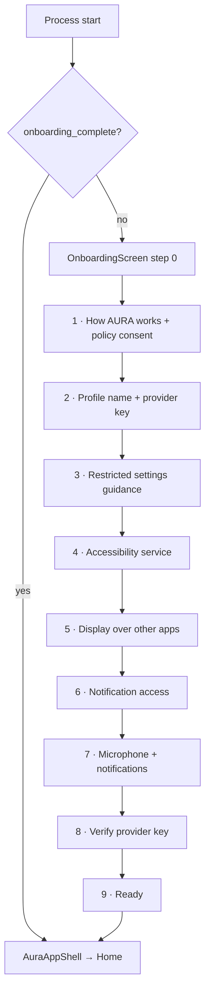
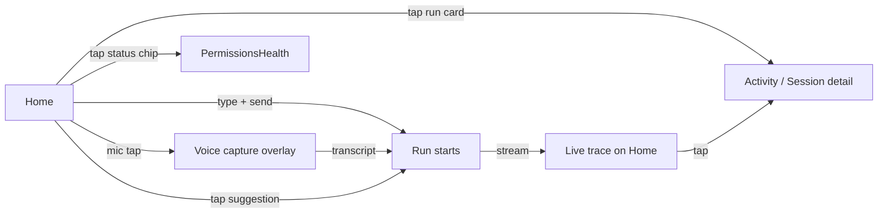
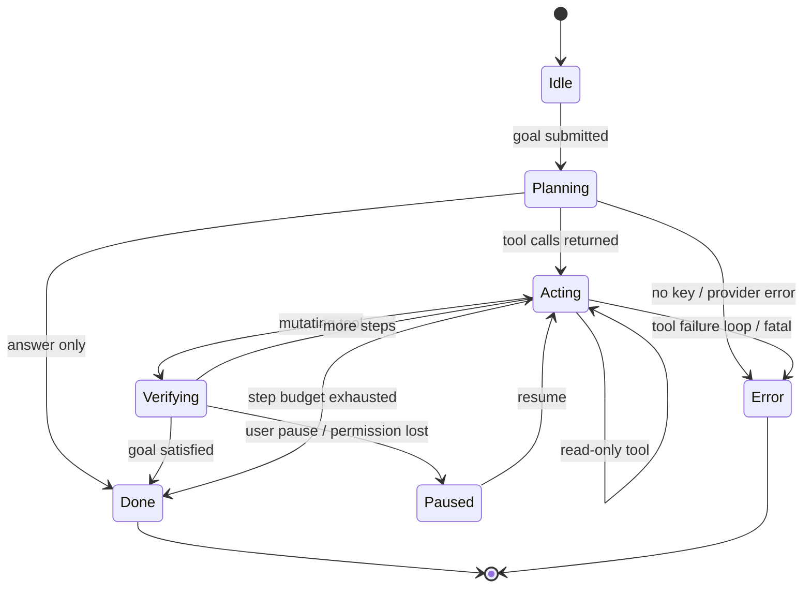
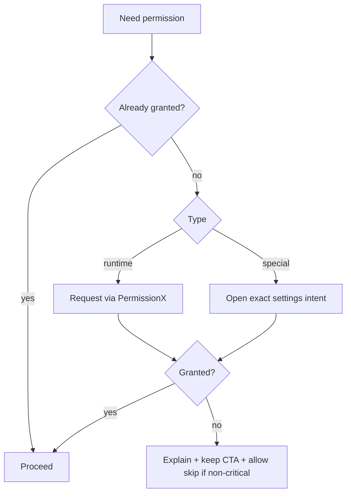
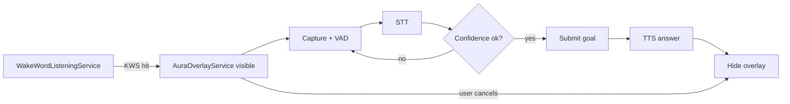
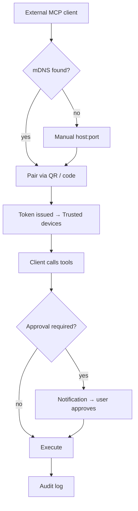

# App Flow — AURA for Android

> Navigation map, every screen, and every state transition. Mermaid diagrams render on GitHub/VS Code.

---

## 1. Top-level structure

AURA uses **one** navigation element: a floating black capsule at the bottom (the "Capsule").
- On top-level tabs it shows **4 icons**: Home · Agent · Activity · Settings.
- On subpages it collapses to `‹ Back · <title>`.

```
┌──────────────────────────────────────────┐
│                                          │
│              Screen content              │
│                                          │
├──────────────────────────────────────────┤
│      ( ● )   ( ○ )   ( ○ )   ( ○ )       │  ← capsule: Home Agent Activity Settings
└──────────────────────────────────────────┘
```

There is no drawer, no top app bar in the main shell, no tab bar anywhere else.

---

## 2. Route table (must match exactly)

| Constant | Route | Screen |
|---|---|---|
| `HOME` | `home` | `AuraHomeScreen` |
| `AGENT` | `agent` | `AgentHubScreen` |
| `ACTIVITY` | `activity` | activity list (sessions) |
| `SETTINGS` | `settings` | `MonoSettingsScreen` |
| `AGENT_BRAIN` | `agent/brain` | `ProviderSettingsScreen` |
| `AGENT_TOOLS` | `agent/tools` | `ToolsScreen` |
| `AGENT_HOOKS` | `agent/hooks` | `HooksScreen` |
| `AGENT_SKILLS` | `agent/skills` | `SkillsScreen` |
| `AGENT_MEMORY` | `agent/memory` | `MemoryScreen` |
| `AGENT_COMPANION` | `agent/companion` | `CompanionScreen` |
| `AGENT_VOICE` | `agent/voice` | `VoiceSettingsScreen` |
| `SETTINGS_TAVILY` | `settings/tavily` | `TavilyKeyScreen` |
| `SETTINGS_TRUSTED_DEVICES` | `settings/trusted_devices` | `TrustedDevicesScreen` |
| `SETTINGS_RESTRICTED_APPS` | `settings/restricted_apps` | `RestrictedAppsScreen` |
| `SETTINGS_PERMISSIONS` | `settings/permissions` | `PermissionsHealthScreen` |
| `SETTINGS_PRIVACY` | `settings/privacy` | `PrivacyPolicyScreen` |
| `SETTINGS_TERMS` | `settings/terms` | `TermsScreen` |
| `SETTINGS_LICENSES` | `settings/licenses` | `LicensesScreen` |
| `EVAL_SUITE` | `eval` | `EvalSuiteScreen` |
| `ACTIVITY_SESSION` | `activity/session/{sessionId}` | `McpSessionDetailScreen` |
| `ACTIVITY_RETENTION` | `activity/retention` | `McpLogRetentionScreen` |

Titles shown in the capsule come from `routeTitles`, with a fallback that capitalises the last path segment.

> **Removed routes (do not recreate):** MCP Center, MCP Servers, MCP session log as a separate tab, sign-in/account, sync.

---

## 3. First launch → onboarding



**Rules**
- Steps 4–7 are *permission* steps: they poll live state and **auto-advance** when granted; a back chevron lets the user revisit.
- Step 1 blocks progression without the policy checkbox.
- Step 8 blocks progression unless a live verification call succeeds.
- Step index is persisted after every change so a process death resumes at the same step.
- Onboarding can be re-entered from Settings → Privacy (reset).

---

## 4. Home



Components on Home:
- Greeting + brand mark
- Prompt composer (multiline, send, mic)
- Suggestion marquee (rotating prompt chips)
- Status chip row (accessibility · capture · voice · MCP)
- Active run card with step stream and Pause button
- Recent runs list

States: `idle → listening → planning → acting(step n) → verifying → done | error | paused`.

---

## 5. Run lifecycle (detailed)



Every transition emits an event: `thinking`, `plan`, `tool_call`, `tool_result`, `verify`, `answer`, `error`, `interrupt`.
Events are persisted as they are emitted, not at the end, so a kill leaves a readable trace.

---

## 6. Agent hub

`agent` is a menu of sub-systems, each with a one-line explanation:

| Item | Destination | Purpose |
|---|---|---|
| Brain | `agent/brain` | Provider, key, model, temperature, vision toggle |
| Tools | `agent/tools` | Full tool inventory with schemas and enabled state |
| Hooks | `agent/hooks` | Deterministic pre/post hooks around runs |
| Skills | `agent/skills` | Reusable prompt+procedure packs |
| Memory | `agent/memory` | Conversations, learnings, reminders |
| Companion | `agent/companion` | Voice companion persona & behaviour |
| Voice | `agent/voice` | Wake word, TTS voice, VAD sensitivity |

---

## 7. Settings

```
Settings
├── Brain (provider + model)                 → agent/brain
├── Voice                                    → agent/voice
├── Permissions health                       → settings/permissions
├── Restricted apps                          → settings/restricted_apps
├── Trusted devices (MCP clients)            → settings/trusted_devices
├── Search key (Tavily)                      → settings/tavily
├── Privacy                                  → settings/privacy
├── Terms                                    → settings/terms
├── Licences                                 → settings/licenses
└── Developer (only if developer_mode_enabled)
    ├── Eval suite                           → eval
    └── Log retention                        → activity/retention
```

---

## 8. Permission flow



Critical (block the run): Accessibility, Screen capture (on demand), Provider key.
Helpful (degrade gracefully): Notifications, Contacts, Media index, Battery optimisation exemption.

---

## 9. Voice flow



Manual path: mic button on Home → same capture pipeline without wake word.

---

## 10. MCP client flow (external control)



---

## 11. Screen inventory (all 41 files)

| File | Role |
|---|---|
| `AuraHomeScreen` | Home / run surface |
| `AgentHubScreen` | Agent menu |
| `ProviderSettingsScreen` | Brain: provider, key, model |
| `ToolsScreen` | Tool catalogue |
| `HooksScreen` | Hooks |
| `SkillsScreen` + `SkillsViewModel` | Skills |
| `MemoryScreen` + `MemoryViewModel` | Memory & reminders |
| `CompanionScreen` + `CompanionViewModel` | Voice companion |
| `VoiceSettingsScreen` | Voice config |
| `MonoSettingsScreen` | Settings root |
| `PermissionsHealthScreen` | Permission audit |
| `RestrictedAppsScreen` | Per-app block list |
| `TrustedDevicesScreen` | Paired MCP clients |
| `TavilyKeyScreen` | Search key |
| `OnboardingScreen` | 10-step wizard |
| `LegalScreens` + `LegalCopy` | Privacy/Terms/Licences |
| `AgentTraceScreen` + `TraceAtoms`/`TraceFormatting`/`TraceVisibility` | Trace rendering |
| `RunCards`, `StoryView`, `PipelineTrail`, `AppPromptMarquee` | Home components |
| `AskUserCard` | HITL confirmation |
| `McpSessionDetailScreen`, `McpSessionLogScreen`, `McpLogRetentionScreen` | Session logs |
| `McpCenterScreen`, `McpServersScreen` (+VM) | **legacy** — keep out of nav |
| `EvalSuiteScreen`, `EvalRunPicker`, `EvalTaskSheet` | Eval harness |
| `VoiceAssistantOverlay` | Floating voice UI |
| `RawBodyViewer`, `TargetCrop`, `ScreenGrid` (in components) | Debug/inspection |

---

## 12. Global UI states

| State | Surface |
|---|---|
| No provider key | Home shows blocking card → `agent/brain` |
| Accessibility off | Status chip red; runs refuse to start |
| Screen capture off | Runs start but vision/receipt tools return `permission_denied` |
| Paused | Pause pill expands; all dispatch blocked |
| Offline | Banner; agent still plans but tool calls that need net fail fast |
| Provider rate-limited | Trace shows retry with countdown |
| MCP server on | Chip shows client count |
| Low memory | *(target)* trim trace buffer, drop screenshots, unload vision model |
